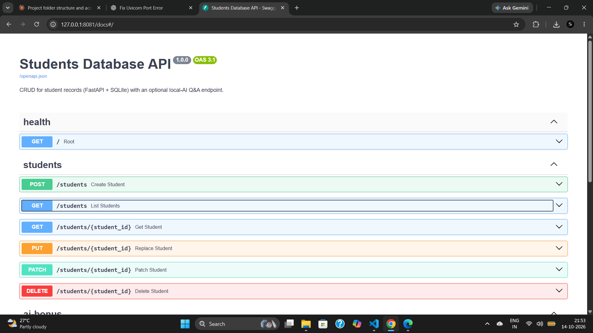
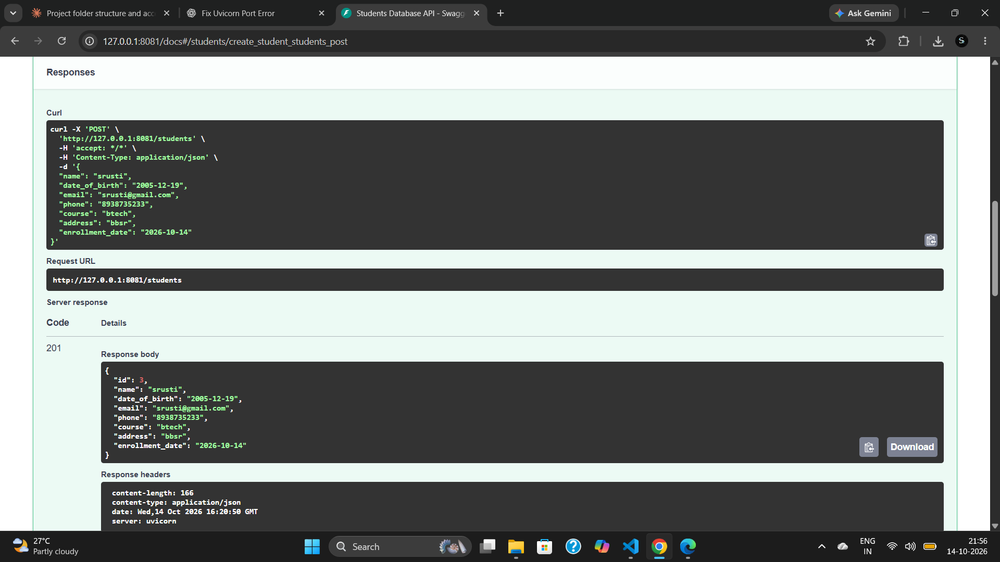
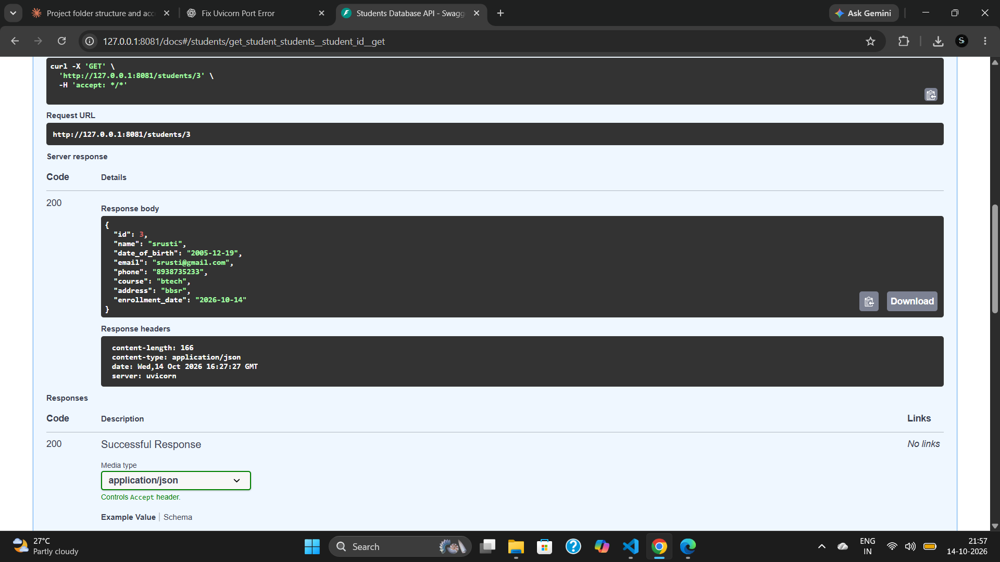
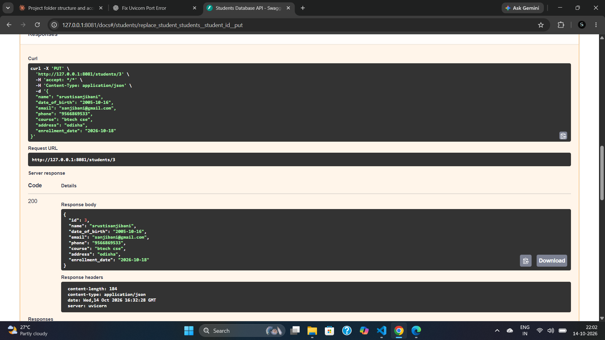
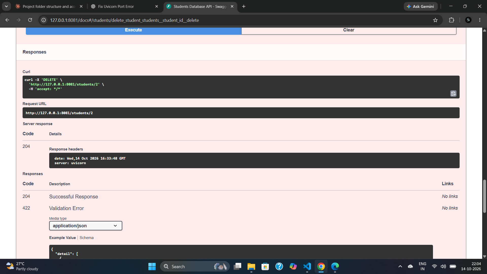

# Students Database CRUD API

**EWB Edu Tech Pvt. Ltd. – Python Backend Internship Project**

A REST API built using **Python, FastAPI, and SQLite** to manage student records. It supports creating, reading, updating, deleting, filtering, and validating student information. An optional local AI question-answering endpoint using Ollama is also included.

## Features

- Complete CRUD operations for student records.
- Persistent SQLite database stored at `data/students.db`, created automatically.
- Search and filtering by name, course, email, and date-of-birth range.
- Pagination using `skip` and `limit`.
- Input validation for names, email addresses, phone numbers, and dates of birth.
- At least one contact method (email or phone) is required.
- Unique email addresses.
- Appropriate error responses for missing records, duplicate emails, and invalid input.
- Interactive API documentation through Swagger UI.
- Optional Ollama-powered AI question-answering endpoint.

## Technologies Used

- Python 3.10+
- FastAPI
- SQLite
- Pydantic
- Uvicorn
- Pytest
- Ollama (optional AI extension)
## 📸 Project Screenshots

### 1. Swagger UI — API Documentation


### 2. Create Student


### 3. Get Students


### 4. Update Student


### 5. Delete Student



## Project Structure

```text
student-db-crud/
├── app/
│   ├── __init__.py
│   ├── main.py         # API endpoints and application setup
│   ├── schemas.py      # Request/response models and validation
│   ├── crud.py         # Database CRUD operations
│   ├── database.py     # SQLite connection and table creation
│   └── ai.py           # Optional Ollama integration
├── data/
│   └── .gitkeep        # Keeps the data directory in Git
├── scripts/
│   ├── __init__.py
│   └── seed.py         # Adds sample demonstration records
├── tests/
│   ├── __init__.py
│   └── test_api.py     # Automated API tests
├── sample_requests.md  # Example API requests
├── requirements.txt
├── .gitignore
└── README.md
```

The SQLite database is created automatically when the application starts. The database file is excluded from Git using `.gitignore`.

## Prerequisites

- Python 3.10 or later
- pip
- Git (for version control and GitHub submission)
- Ollama only if you want to use the optional AI endpoint

Check your Python installation:

```bash
python --version
```

## Installation

Open a terminal in the project directory:

```bash
cd student-db-crud
```

Create a virtual environment:

```bash
python -m venv .venv
```

Activate it on Windows PowerShell:

```powershell
.venv\Scripts\Activate.ps1
```

On macOS or Linux:

```bash
source .venv/bin/activate
```

Install the dependencies:

```bash
pip install -r requirements.txt
```

## Run the Application

Start the FastAPI server on port `8081`:

```bash
python -m uvicorn app.main:app --reload --host 127.0.0.1 --port 8081
```

Open the interactive API documentation:

**Swagger UI:** http://127.0.0.1:8081/docs

**API root:** http://127.0.0.1:8081/

You can use Swagger UI to execute and test the endpoints directly from your browser.

## API Endpoints

| Method | Endpoint | Description |
|---|---|---|
| POST | `/students` | Create a student |
| GET | `/students` | List and filter students |
| GET | `/students/{student_id}` | Retrieve a student by ID |
| PUT | `/students/{student_id}` | Replace a student's details |
| PATCH | `/students/{student_id}` | Update selected fields |
| DELETE | `/students/{student_id}` | Delete a student |
| POST | `/ask` | Ask a question using the optional AI extension |

### Student Fields

| Field | Description |
|---|---|
| `id` | Automatically generated unique ID |
| `name` | Student's name; required |
| `date_of_birth` | Date of birth in `YYYY-MM-DD` format; required and must be in the past |
| `email` | Valid, unique email address; optional if a phone number is provided |
| `phone` | Phone number; optional if an email is provided |
| `course` | Course name; optional |
| `address` | Student address; optional |
| `enrollment_date` | Enrollment date; optional |

### Example: Create a Student

Send a `POST` request to:

`http://127.0.0.1:8081/students`

Request body:

```json
{
  "name": "Demo Student",
  "date_of_birth": "2005-06-15",
  "email": "demo@example.com",
  "phone": "9876543210",
  "course": "Computer Science",
  "address": "Bhubaneswar, Odisha",
  "enrollment_date": "2026-10-12"
}
```

A successful creation returns **201 Created** and the new student's details, including the generated ID.

### Filtering and Pagination

The `GET /students` endpoint supports the following query parameters:

| Parameter | Purpose |
|---|---|
| `name` | Partial name match |
| `course` | Partial course match |
| `email` | Exact email match |
| `born_after` | Students born after the specified date |
| `born_before` | Students born before the specified date |
| `skip` | Number of records to skip; default `0` |
| `limit` | Maximum records to return; default `100`, maximum `500` |

Example:

```text
http://127.0.0.1:8081/students?course=Computer&skip=0&limit=10
```

## Error Handling and Validation

The API uses appropriate HTTP status codes:

| Status code | Meaning |
|---|---|
| `200 OK` | Request succeeded |
| `201 Created` | Student created successfully |
| `204 No Content` | Student deleted successfully |
| `404 Not Found` | Student ID does not exist |
| `409 Conflict` | Email address already exists |
| `422 Unprocessable Entity` | Request data failed validation |
| `503 Service Unavailable` | Optional Ollama service is unavailable |

## Run Automated Tests

With the virtual environment activated, run:

```bash
python -m pytest -q
```

The automated tests are located in `tests/test_api.py`. They are designed to test API functionality using a test database.

## Load Sample Data (Optional)

To insert demonstration records, run:

```bash
python -m scripts.seed
```

Use sample or dummy information for demonstrations. Avoid adding real student data to the repository.

## Optional AI Extension: Ollama

The project includes an optional `/ask` endpoint that can answer supported natural-language questions about student records.

Install Ollama from [https://ollama.com](https://ollama.com), then download the configured model:

```bash
ollama pull llama3.2:1b
```

Ensure Ollama is running before calling the endpoint. If necessary, start it with:

```bash
ollama serve
```

Example request:

```bash
curl -X POST http://127.0.0.1:8081/ask -H "Content-Type: application/json" -d "{\"question\":\"How many students are there?\"}"
```

The backend selects records using its own fixed, parameterised database queries and passes the resulting context to the AI model. The model does not execute SQL directly.

Configuration options:

- `OLLAMA_URL`: Ollama server URL; defaults to `http://localhost:11434`.
- `OLLAMA_MODEL`: Model name; defaults to `llama3.2:1b`.

The CRUD API works independently of Ollama.

## Security and Data Handling

- SQL queries use parameterised values to reduce SQL injection risks.
- Email uniqueness and required contact information are enforced.
- Local database files are excluded from Git.
- No API keys or passwords are required for the core CRUD functionality.
- Do not commit real student information or sensitive data.

## Author

**Project:** Students Database CRUD API  
**Organization:** EWB Edu Tech Pvt. Ltd.  
**Track:** Python Backend Internship

